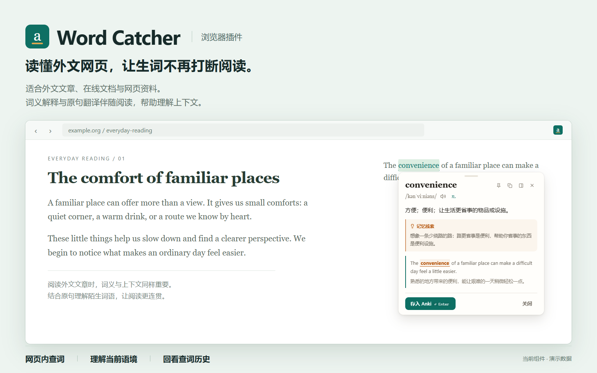

  
  <h1>Word Catcher · 浏览器插件</h1>
  
读懂外文网页，让生词不再打断阅读。

  
<a href="https://github.com/qup1010/WordCatcher/releases">下载插件</a> · <a href="https://github.com/qup1010/WordCatcherDesktop">Windows 桌面版</a> · <a href="https://github.com/qup1010/WordCatcher/issues">反馈问题</a>

Word Catcher 是一款浏览器查词工具，适合阅读外文文章、在线文档和网页资料。词义解释与原句翻译直接呈现在当前页面，帮助你理解上下文、继续阅读；最近的查询记录也方便随时回看。

## 选择适合阅读场景的版本

| 产品 | 更适合的场景 | 主要用途 |
| --- | --- | --- |
| **浏览器插件（本项目）** | 外文文章、在线文档与网页资料 | 在当前网页理解词义和语境，管理并复习单词本 |
| [Windows 桌面版](https://github.com/qup1010/WordCatcherDesktop) | PDF 文献、Word 文档与桌面阅读 | 跨应用查词，积累生词与原句 |

两者都提供离线词典、在线快译和 AI 语境详解，可以按阅读场景搭配使用。配置、离线词典和查询历史各自保存在本地；启用 WebDAV 并在两端配置相同的 HTTPS 地址和文件路径后，收藏的词条与语境可在插件和桌面版之间同步。单词本也可以通过 JSON 备份手动导入。

## 安装插件

### Chrome / Edge

1. 打开 [Releases](https://github.com/qup1010/WordCatcher/releases)，下载 `word-catcher-<版本>-chrome.zip`，解压到固定目录。
2. Chrome 打开 `chrome://extensions`；Edge 打开 `edge://extensions`。
3. 开启「开发者模式」，选择「加载已解压的扩展程序」，选择解压后**包含 `manifest.json` 的目录**。
4. 将 Word Catcher 固定到工具栏，刷新原来已打开的网页，再开始划词。

安装后保留解压目录。更新时先完全解压新包，在扩展管理页重新加载或重新选择对应目录，再刷新网页。

### Firefox

1. 下载 `word-catcher-<版本>-firefox.zip` 并解压。
2. 打开 `about:debugging#/runtime/this-firefox`，选择「临时载入附加组件」，选中解压目录中的 `manifest.json`。
3. 刷新网页后使用。

这是 Firefox 的 [临时加载方式](https://developer.mozilla.org/en-US/docs/Mozilla/Add-ons/WebExtensions/Your_first_WebExtension#installing)，重启浏览器后需要重新加载。当前发布压缩包不等同于已签名的长期安装包。侧边栏打开功能依赖浏览器的 `sidePanel` API，Firefox 当前无法通过该入口打开；可使用网页查词卡片和工具栏弹窗。

需要从源码构建时，参阅 [开发说明](docs/development.md)。

## 第一次查词

1. 打开一篇正常网页中的英文文章，划选一个单词或短句。
2. 默认会在选区附近出现查词胶囊。点击「快译」，查看词典结果或在线翻译。
3. 已配置 AI 时，可以点击「AI」结合当前原句解释含义。
4. 继续阅读；需要回看时，从工具栏弹窗打开最近的查询记录。

快译无需 AI API Key；安装离线词典后，命中的短词可离线查询。点击工具栏中的 Word Catcher 图标，可以手动输入查询，也可以进入设置。Chrome / Edge 还可从界面中的侧边栏入口继续查词。

### 选择适合自己的查词方式

| 方式 | 查询内容 | 使用条件 |
| --- | --- | --- |
| 离线词典 | 常用义、音标、完整义项、例句和记忆线索 | 先安装词典；命中后无需联网 |
| 快译 | 已启用的离线词典优先；未命中或长句走在线机翻 | 在线部分需要网络，可选择 Microsoft 或 Google |
| AI 详解 | 当前语境中的词义与整句翻译 | 配置兼容接口、模型和 API Key |

在「设置 → 划词与朗读」中可以切换为直接快译、直接 AI 或自动模式，也可以设置修饰键、双击取词、释义语言、朗读速度和不启用划词的域名。设置修改会自动保存，请留意保存结果提示。

离线词典将普通词性排在姓名、专名之前，同一词性内按核心、常用、少见义稳定排序。摘要覆盖全部有效词性，每个词性最多 3 条不同释义；优先使用核心和常用义，仅有少见义时仍会展示。网页卡片、侧边栏、复制与保存使用同一份摘要，网页卡片与侧边栏共用结构化词典视图，展开「完整释义」保留全部义项。详情依次展示短释义、补充解释、例句和用法提示；默认显示一条例句，其余可通过「更多例句」展开。

## 安装离线词典

1. 进入设置的「离线词典」区域，启用词典。
2. 使用默认地址下载，等待导入完成；也可以先下载文件，再选择本地文件导入。
3. 查询常见英文单词，确认结果显示为离线词典。

默认来源是 [Open Dictionary](https://github.com/ahpxex/open-dictionary) 的 `distribution.jsonl.gz`，手动下载见其 [Releases](https://github.com/ahpxex/open-dictionary/releases)。插件使用 JSONL 词典，并将内容保存在浏览器本地 IndexedDB 中；桌面版的 SQLite 词典文件不能直接导入插件。

词典卡片先展示常用释义，完整义项和记忆线索可以展开查看。词典未就绪或没有命中时，快译会使用在线服务。

## 配置 AI

1. 进入设置的 AI 区域，新建或选中一套配置。
2. 填写服务提供方的 **Base URL、API Key 和模型名**。Base URL 填兼容接口的基础地址，通常包含 `/v1` 等版本路径，不需要填完整的 `/chat/completions` 地址。
3. 获取模型列表，或手动填写准确的模型名称。
4. 测试连接，再使用设置中的 AI 示例或实际划词检查语境释义。

支持多套配置并切换当前配置。连接测试通过只说明基础请求可用；实际查词还需要模型支持结构化输出。API 调用的网络条件、费用和额度由你选择的提供方决定。

AI 会将划选文字和可获取的原句发送到该接口。同一词在同一语境中的 AI 结果会暂存在内存，减少重复请求；浏览器回收后台进程后缓存会清空，也可在「数据与单词本」中手动清理。

## 历史记录、备份与隐私

工具栏弹窗和侧栏中可回看最近查询。历史保留最近 **100** 条记录，同词同句更新记录，不同语境分别保留；查询历史不会自动成为收藏。

AI 结果提供语境义、原句翻译和学习表达，必要的理解与用法可以展开查看。生成完成后才能保存；释义、译文和个人笔记可以单独编辑，重新生成会保留用户修改。

点击网页卡片或侧栏的「存入单词本」会先保存本地学习记录，再尝试同步 Anki。侧栏的「单词本」按词聚合多条语境，支持搜索、编辑、重开分析、逐条同步和删除。也可以进入单词本复习，朗读词条、随机排序并切换答案显示。

单词本支持 JSON 导入与导出。导入会补入备份中尚未保存的语境，不覆盖已有记录；相同语境重复保存不会创建新记录，需要明确更新。原始选区、来源和 AI 结果与用户编辑分别保存。

| 数据 | 保存位置或处理方式 |
| --- | --- |
| 设置、AI API Key、查询历史、本地单词本、待写队列 | 浏览器扩展的本地存储；API Key 未加密 |
| 离线词典 | 浏览器本地 IndexedDB |
| AI 查询缓存 | 后台进程内存，最多 50 条，进程回收后清空 |
| 已写入 Anki 的卡片 | 由 Anki 管理 |

在「设置 → 数据与单词本」中可以分别导入或导出单词本 JSON 和**配置备份**。配置备份包含明文 API Key，应像密钥一样保管；导入会替换当前配置。配置备份不包含查询历史、单词本、待写队列、离线词典、AI 缓存或 Anki 卡片。

历史用于回看近期查询，单词本用于长期收藏和复习。启用 WebDAV 并在两端配置相同的 HTTPS 地址和文件路径后，可与桌面版同步单词本。卸载插件或清除扩展数据可能丢失本地记录；请定期导出单词本 JSON。跨设备复习仍可使用 Anki 自身的同步。

### 权限与网络请求

- 网页访问权限用于读取选中文字、所在原句并显示查词界面；当前配置也允许访问用户自定义的 AI 接口。
- 离线词典命中时查询在本地完成，下载词典时会访问所配置的下载地址。
- 在线快译会将待翻译文字发送到所选择的翻译服务；AI 会将划选文字和原句发送到配置的 AI 服务。
- 存入 Anki 时会将词条、语境和来源网页信息发送到配置的 AnkiConnect 地址，默认是本机。
- 当前使用浏览器本地存储，不会通过浏览器账号自动同步插件设置和历史记录。

<strong>可选：存入 Anki 复习</strong>

如果你已经使用 Anki，可以把词条和原句保存为复习卡片。查词、语境详解与历史回看均可独立使用。

1. 安装并打开 [Anki 桌面版](https://apps.ankiweb.net/)。
2. 在 Anki 中打开「工具 → 插件 → 获取插件」，填写 **`2055492159`** 安装 [AnkiConnect](https://ankiweb.net/shared/info/2055492159)，然后重启 Anki。
3. 在插件设置的 Anki 区域填写地址、牌组和笔记类型。默认地址为 `http://127.0.0.1:8765`，牌组和笔记类型均为 `Word Catcher`。
4. 测试连接，保持 Anki 运行，在查词卡片中点击「存入单词本」。
5. 到 Anki 对应牌组检查词条、释义与原句。

插件会创建所需牌组和笔记类型。来自单词本的卡片按语境身份创建或更新：同词不同语境可以分别创建笔记，同一语境更新原有笔记；较长解释留在单词本，Anki 导出简洁的语境义、原句、译文及必要用法。语境卡片使用实际选区位置，便于在重复单词的原句中定位本次选中的词。

### Anki 未打开时怎么办

无法连接时，卡片会留在本机待写队列。打开 Anki 后，进入「设置 → 外部拓展联动」，点击「立即同步至 Anki」。不要将进入队列理解为已写入 Anki；写入结果以同步提示与 Anki 中的笔记为准。

队列按语境去重，同语境保留最新待同步版本；删除某条待同步语境不会删除同词其他语境，也不会删除本地单词本记录。旧版待写卡片仍可同步。需要跨设备复习时，使用 Anki 自身的同步功能。

### Anki 测试连接失败

确认 Anki 已打开，AnkiConnect 已安装并已重启，插件中的地址与端口正确。若卡片已经排队，可在连接恢复后手动补写。

## 常见问题

### 划选后没有胶囊或卡片

安装或更新后先刷新网页；检查是否设置了修饰键、域名黑名单，是否允许插件访问当前网站。浏览器内部页面、扩展商店和部分内置 PDF 阅读器不允许普通内容脚本运行。扫描件或图片也没有可直接读取的网页文本。

在受限制页面中，可从工具栏弹窗手动输入查词；Windows 用户还可尝试 [桌面版](https://github.com/qup1010/WordCatcherDesktop)。

### 快译失败或 AI 一直报错

检查网络，或在设置中切换机翻服务。AI 需核对接口地址、密钥、模型名称与额度；基础连接成功但语境查询失败时，检查模型对结构化输出的支持。

### 朗读没有声音

确认浏览器和系统有可用的语音音色、系统未静音，并检查朗读语言设置。朗读使用浏览器的语音能力，音色和可用语言取决于系统与浏览器。

### 如何反馈问题

到 [Issues](https://github.com/qup1010/WordCatcher/issues) 提供插件版本、浏览器版本、问题页面类型、复现步骤和错误提示。分享截图或配置前，去掉私人语境和 API Key。

## 项目与许可

- Windows 中的 PDF、Word 等阅读场景可使用 [Word Catcher 桌面版](https://github.com/qup1010/WordCatcherDesktop)。
- 构建、测试与发布见 [开发说明](docs/development.md)，验证记录见 [文档索引](docs/README.md)。
- 插件代码使用 [MIT License](LICENSE)。离线词典来自 [Open Dictionary](https://github.com/ahpxex/open-dictionary)，数据署名包括 English Wiktionary 及其贡献者、Wiktextract，并按 [CC BY-SA 4.0](https://github.com/ahpxex/open-dictionary/blob/main/LICENSE-DATA.md) 授权，独立于插件代码许可。
